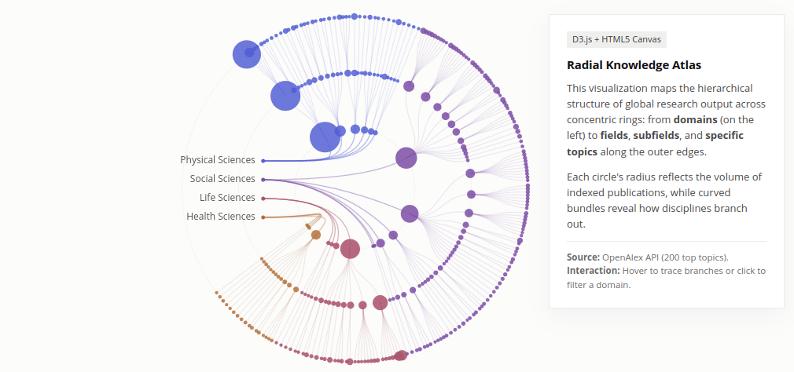

# Radial Atlas

Interactive radial hierarchy visualization of global research topics built with **D3.js** and **HTML5 Canvas** using live data from the **OpenAlex API**, mapping domains on the left to fields, subfields, and topics across concentric rings where circle size reflects publication count and curved paths trace branching relationships, with hover lineage highlighting and click domain filtering. 

